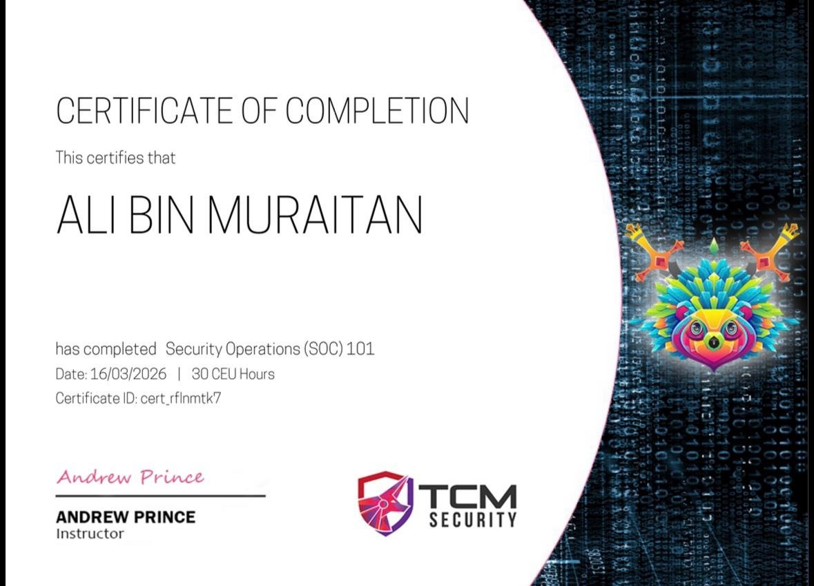
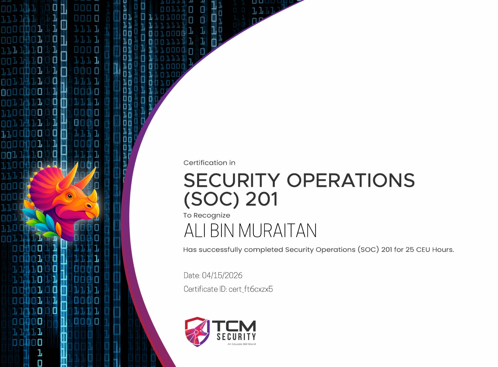
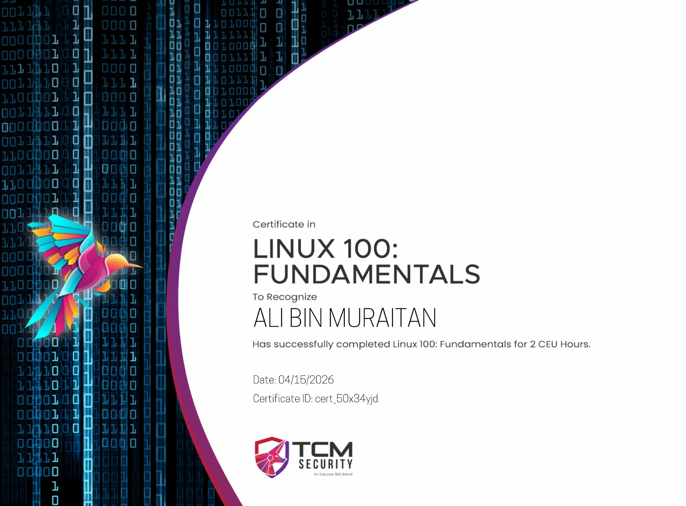
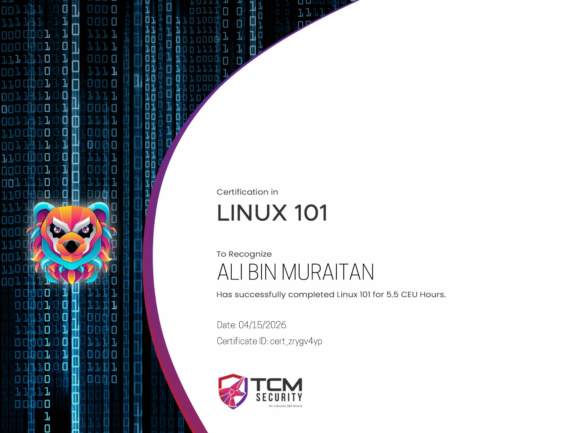
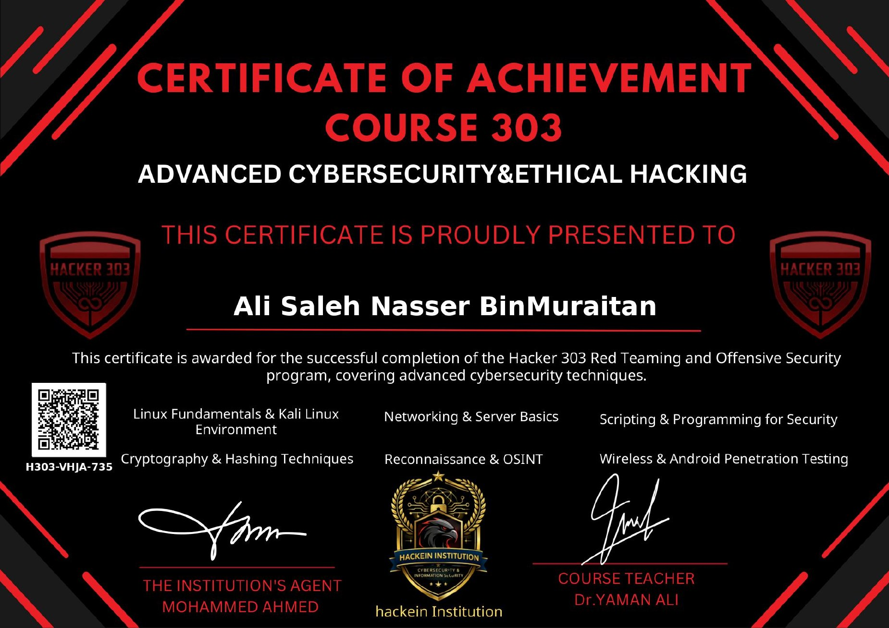

# Ali Bin Muraitan

**Cybersecurity Engineering Student | SOC & Blue Team | CTF**

I’m a cybersecurity engineering student at the University of Science and Technology, Yemen. I focus on security operations and defensive security, and I’m building my skills in network traffic analysis, threat detection, and incident response through coursework and practice. I’m seeking a cybersecurity internship.

## Selected projects

| Project | Status | Overview |
| --- | --- | --- |
| **[4L1-Check](https://github.com/alimuraitan/4l1-check)** | Personal project | A local Python and Flask tool for web security testing in authorized labs. |
| **[CYS IDEA](https://github.com/alimuraitan/cys-idea-planner)** | Independent project | An Arabic student planner built with Laravel and Blade for lectures, tasks, and exams. |
| **LLMGuard** | Team graduation project in development | A platform we’re building to assess large language models for risks such as prompt injection, jailbreaks, and data leakage. |
| **CyberSpace** | Personal project in development | An Arabic cybersecurity learning app using Flutter, Dart, and Material 3, designed around practical exercises and CTF challenges. |

## Technical toolkit

- **Security and systems** · Linux, Wireshark, and Nmap
- **Development** · Python and Flask, Flutter and Dart, and Laravel

## Training and certificates

| Issuer | Course | Issued | Certificate image |
| --- | --- | --- | --- |
| TCM Security | Security Operations (SOC) 101 | Mar 2026 |  |
| TCM Security | Security Operations (SOC) 201 | Apr 2026 |  |
| TCM Security | Linux 100: Fundamentals | Apr 2026 |  |
| TCM Security | Linux 101 | Apr 2026 |  |
| Hackein Institution | Course 303 – Advanced Cybersecurity & Ethical Hacking | Oct 2026 |  |

Select an image to view the full-size certificate.

[Credential records on LinkedIn](https://www.linkedin.com/in/ali-bin-muraitan/details/certifications/)

## 4L1 | Cybersecurity

I create Arabic cybersecurity awareness content on phishing, password security, and social engineering as 4L1.

[LinkedIn](https://www.linkedin.com/in/ali-bin-muraitan/) · [Instagram](https://www.instagram.com/3nri4/)
